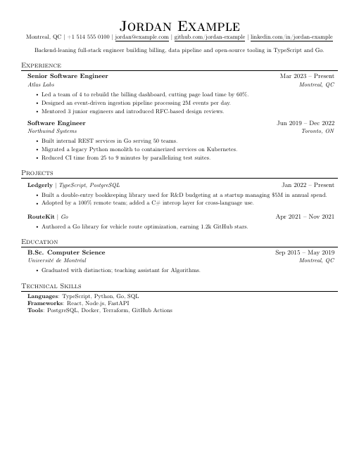
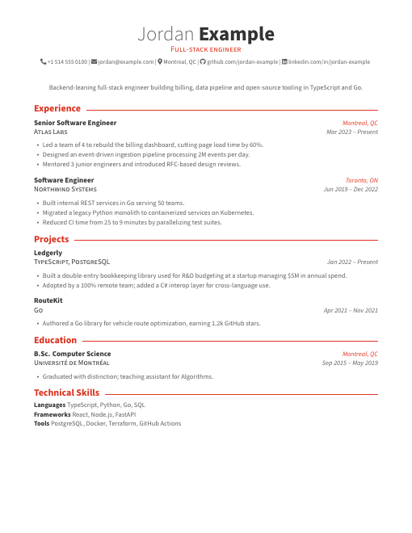
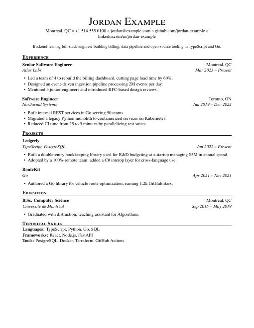
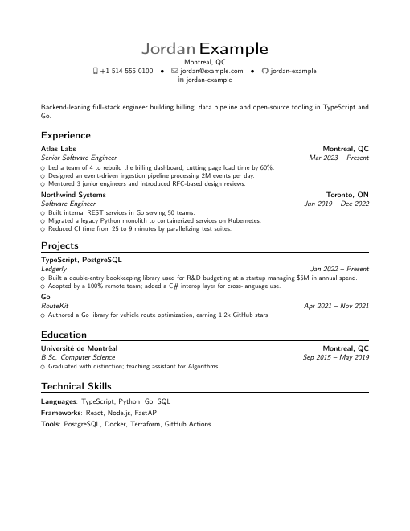

# resumely

Tailor your resume and a cover letter to a job posting using the coding agent you already have. You keep a profile of markdown files describing your experience. `resumely apply` parses a job description, researches the company on the web, then drives a headless coding-agent CLI (claude, codex or pi) to select and reword real entries from your profile into a one-page resume and a one-page cover letter, compiled to PDF with LaTeX. Every bullet is traced back to the profile entries it came from, titles, employers, locations and dates are filled in from your entries rather than written by the agent, skills must exist in your profile, and requirements your profile doesn't cover are listed as gaps instead of being invented.

## Prerequisites

- [Bun](https://bun.sh)
- TeX Live with `latexmk` (to compile the PDF)
- One agent CLI, installed and logged in: `claude`, `codex`, or `pi` (pi needs a configured provider; see [Adapters](#adapters))

## Install

```sh
bun install
bun link        # puts `resumely` on your PATH
```

## Quickstart

```sh
resumely init                # creates ~/resumely/ with a starter profile and config.toml
# edit ~/resumely/profile/   (about.md, skills.yaml, experience/, projects/, education/, extras/)
resumely apply --clip        # job description from the clipboard (or pass a file or URL)
resumely ls                  # list applications
resumely open <app>          # open the latest resume PDF, or the cover letter if there is no resume (--version N for another)
```

### apply

```sh
resumely apply [input] [--clip] [--harness <name>] [--template <id>] [--pages <n>]
               [--stretch] [--no-cover] [--no-research] [--no-review] [--review]
               [--role <title>] [--into <app>] [--new] [--no-open]
```

The job comes from a file, a URL, `--clip`, or, when you run `apply` with no input in a terminal, from `$VISUAL`/`$EDITOR` (paste the posting, save and close; an empty file cancels). The editor command is split into argv and never goes through a shell.

- `--stretch`: allow inferred claims (reasonable but not stated in your profile). They are printed as `inferred claims to review:` and marked in the trace; default mode is truthful.
- `--no-cover`, `--no-research`, `--no-review`: skip the cover letter, the company research, or the review loop.
- `--review`: pause after the job is parsed so you can confirm it (interactive terminals only).
- `--pages <n>`: resume page target (default 1).
- `--role <title>`: when a posting lists several roles, resumely uses the most prominent one and notes the others in the output; `--role` picks another.
- `--into <app>` adds a new version to an existing application; `--new` creates a separate one. If a duplicate of the same job exists and you pass neither, you are asked.

Other commands:

- `ls [--status <s>] [--company <text>]`, `open <app> [--cover] [--version N]`
- `mv <app> [--company <name>] [--role <title>]`: change an application's company and/or role and rename its folder
- `templates list` / `templates new <id> [--from <base>]`: list built-in and user templates, or copy one into `<root>/templates/<id>/` to edit
- `doctor`: check harnesses, LaTeX, templates and the data root
- `resume [run-id] [--harness <name>]`: continue a failed run (see [Checkpoints and resume](#checkpoints-and-resume))
- `render <app> --template <id> [--cover] [--version N]` re-renders a saved version with the given template (required) without calling the agent
- `status <app> <drafted|applied|interviewing|rejected|offer>`: `applied` is refused while a document is not ready unless you pass `--force`
- `note <app> <text...>`: dated note on an application
- `export <app> [--version N] [--to <dir>]`: copy the send-ready PDFs of whichever documents exist (default `~/Desktop`)
- `profile show [id]`, `profile context`

Postings from a recruiting agency with an undisclosed client are recorded as `Confidential (via <agency>)`: the folder name comes from the agency and the role, and company research is skipped.

Set `RESUMELY_HOME` to use a different data root. Every run produces versioned outputs under `applications/<date>-<company>-<role>/{resume,cover-letter}/vN/` (PDF, source, trace, `review.json`, `meta.json`).

## Templates

Four single-column, ATS-readable templates, each with a matching cover letter. Choose one with `--template <id>` or `template = "..."` in `config.toml`; `resumely render <app> --template <id>` re-renders a saved version without calling the agent.

| ID | Based on | Engine | Preview |
|---|---|---|---|
| `classic` (default) | Jake's Resume (MIT) | pdfLaTeX |  |
| `modern` | Awesome-CV (LPPL 1.3c), uses fontawesome5 from stock TeX Live | LuaLaTeX |  |
| `traditional` | McDowell CV (MIT) | XeLaTeX |  |
| `minimal` | moderncv `banking` (LPPL 1.3c) | pdfLaTeX |  |

`resumely templates list` shows built-in and user templates. `resumely templates new mine --from minimal` copies a template into `<root>/templates/mine/`, where you can edit it (Nunjucks with `((* *))` / `((( )))` delimiters; everything is LaTeX-escaped). `bun run previews` regenerates the preview images.

## Doctor

`resumely doctor` checks that the data root and profile load; that each harness is installed and authenticated; that `latexmk` and the engines (pdflatex, xelatex, lualatex) exist; that every template's packages and fonts are available; and that `pdftotext` is present. It exits 1 only when a required check fails (pi is optional). The `pi` preset has no login probe because its provider varies, so doctor reports it as "not checked" with a hint; set `adapters.pi.auth_check` to enable one.

## Checkpoints and resume

Every pipeline step writes its output and `state.json` under `.runs/<run-id>/` before the next step starts. If a run fails (rate limit, timeout, Ctrl-C, ...), `apply` prints `resume with: resumely resume <id>`. `resumely resume [run-id] [--harness <name>]` continues from the last finished step, printing `reused from checkpoint` for steps it does not repeat; with no id it picks the most recent failed run, and `--harness` switches harness for the remaining steps (for example when the first one is rate limited). Refusals from the duplicate-application check ("Already applied") abort the run and are not resumable.

To fail over automatically, opt in with `fallback_harnesses = ["codex", "pi"]` in `config.toml` (off by default). A step that the primary harness cannot run (not installed, auth, rate limit, timeout) is retried on the next harness, and `apply` warns which steps ran on a fallback. The per-call timeout is `timeout_minutes` (default 10).

## Cover letters and voice samples

The cover letter is written from your profile, the job and the company research, never from the finished resume. To make it sound like you, put 1 to 3 samples of your own writing (plain markdown, a few hundred words each) in `profile/voice/`. They are used only as a style reference; without them the letter is still written, in a plainer default voice. Letters are checked for banned filler phrases and for claims that no profile entry or research fact supports.

## Company research and privacy

Before writing, the agent searches the web for the company (what it does, recent news, engineering culture) using the harness's own web tools. The research step receives exactly one data file, `target.json`, holding the company name, the role title, the location (if the posting states one) and the posting's URL (if you applied from a URL), plus the output schema. It does not receive the job posting text, your profile or anything else from your data root: it runs in a fresh temporary directory outside the data root, and only its output and logs are copied back to `.runs/<run>/research/`. Fetched pages are treated as untrusted data. Facts must carry a source URL. If nothing verifiable is found (an unknown or fictional company, say) the research returns no facts, `meta.json` records `research: "none_found"`, and the letter is written from the posting alone rather than guessing. `apply` prints `warning: research failed` only when the step itself fails. The research step never sees your profile. `claude` and `codex` have research presets; `pi` has no web tools, so research is skipped with a warning unless you set `research_command` on your adapter. `--no-research` skips it.

## Review loop and ready gates

Each document goes through: write, compile, hard checks (ATS-readable text, page count, trace of every claim to profile entries), an HR-persona review, and up to 2 revision rounds. Resume and cover letter run concurrently. Expect roughly 8 to 17 minutes per application with the real harnesses (measured: claude 8 to 12 min, codex about 12 min, pi about 17 min), since each stage is a separate headless agent call. `meta.json` records `rounds`, `reviewed_final` (whether the final text is the one the last review judged, whatever its verdict), `research` (`used`, `none_found`, `skipped` or `failed`) and `review_verdict` (that last review's verdict). The reviewer asks for a revision only when a fix would plausibly change a recruiter's shortlist decision (or on overflow, an ATS failure or a templated letter); other suggestions stay in `review.json` as polish. A revision that changes nothing ends the loop.

A version is **ready** when an ATS can read the PDF and it fits its page target. If not, `apply` prints `not ready: <reason>`, exits with status 1, and `status ... applied` is refused without `--force`. A version that still got a `revise` verdict after the last round is still ready, but check `review.json` for what the reviewer wanted. Requirements your profile can't back are listed as `gaps:` (add them to your profile if true), not invented.

## Profile format

One markdown file per entry, with YAML front matter. Example `profile/experience/atlas-labs.md`:

```markdown
---
id: exp-atlas-labs
type: experience
title: Senior Software Engineer
org: Atlas Labs
location: Montreal, QC
start: 2023-03
end: present
skills: [TypeScript, React, PostgreSQL]
tags: [backend]
---

## Highlights

- Led a team of 4 to rebuild the billing dashboard, cutting page load time by 60%.
- Designed an event-driven ingestion pipeline processing 2M events per day.

## Private

Was told the team will be laid off in Q3.
Compensation: 145000 CAD plus equity.
```

A `## Private` section (also `## Private:` or `## Private notes`, up to the next `## ` heading) and `private:` keys in `about.md` front matter are **never included in what resumely sends to the agent**: they are stripped before the agent's workspace files are written, so they don't reach the prompt or the resume. Use them for context you want to keep next to the entry but not share. Other sections, such as `## Notes`, are visible to the agent; `resumely profile context` warns about other headings that mention "private" (such as `### Private`) but are not withheld.

### Agent access

The writer and reviewer agents run with file tools in a workspace inside your data root (`~/resumely/.runs/<run>/`, kept as a debug trail), so they could read other files there, including your raw profile. The web-capable research agent runs outside the data root (see [Company research and privacy](#company-research-and-privacy)). How far it can reach depends on the harness: for writing and review, `claude` is limited to the tools in `--allowedTools`, `codex` runs in its `workspace-write` sandbox, and `pi` has no sandbox. In the research step, `claude` gets only `WebSearch`, `WebFetch` and `Write` (`--tools`) and no MCP servers (`--strict-mcp-config`); `codex` has only its `--search` flag plus cwd isolation (a temp directory outside your data root), not a tool allowlist. Job postings are untrusted input; treat job URLs from unknown sources with care.

### Debugging what the agent sees

```sh
resumely profile context
```

Prints the exact profile content that is handed to the agent, with private content removed.

## Adapters

Built-in presets exist for `claude`, `codex` and `pi`. Choose one with `harness = "..."` in `~/resumely/config.toml` or `--harness`. Override a preset or add your own; commands are argv arrays (no shell), with `{prompt}`, `{workspace}` and `{model}` substituted. `{model}` takes the adapter's optional `model` key; when no model is set, an argv element that is exactly `"{model}"` is dropped together with the flag just before it, so `"--model", "{model}"` simply disappears. The presets don't pass a model, so to pick one, override the adapter:

```toml
[adapters.claude]
command = ["claude", "-p", "{prompt}", "--model", "{model}", "--permission-mode", "acceptEdits", "--allowedTools", "Read Write Edit Glob"]
model = "sonnet"
```

Using pi with a specific provider:

```toml
harness = "pi"

# (example provider — use one you've configured)
[adapters.pi]
command = ["pi", "-p", "--no-session", "--provider", "openai-codex", "--tools", "read,write,edit", "{prompt}"]
check = ["pi", "--version"]
```

The pi preset defaults to pi's default provider (google). If that provider isn't authenticated, override the adapter as above with a provider you have set up (`pi auth check --provider <name>`); pi requires a configured provider.

## Evaluating harnesses

```sh
bun run eval [--harness claude,codex] [--jobs backend,mismatched] [--out <dir>] [--stretch]
```

Opt-in and slow: runs the full pipeline over the fixture postings in `tests/fixtures/jobs/` in a throwaway data root (your real one is only read for custom adapters) and prints a table of readiness, ATS, review scores, rounds, gaps, fabrication count and wall time, plus the expected-gap check for `mismatched`. It makes real LLM calls and is never run by `bun test`. Measured with claude on 2026-11-11: `backend` 2:59 and `mismatched` 3:58 (both ready, `mismatched` meets its expected gaps); a full `apply` with the `modern` template took 6:35 including two review rounds.

## Status: P3

Works now:

- `init`, `profile show`, `profile context`
- `apply`: job parse, company research, tailored resume and cover letter with review loop, gaps, traces, `--stretch`, `--role`, `$EDITOR` intake, agency postings
- Four templates, `templates list|new`, `doctor`
- Checkpointed runs with `resume`, opt-in `fallback_harnesses`, locked-down research agent
- Versioned applications: `ls`, `open`, `render`, `status`, `note`, `mv`, `export`
- `bun run eval` baseline
- Private-content withholding
- claude and codex verified end to end including web research; pi verified with a provider override (research skipped, no web tools)

Coming next:

- Roadmap beyond P3: see [design.md](design.md)
